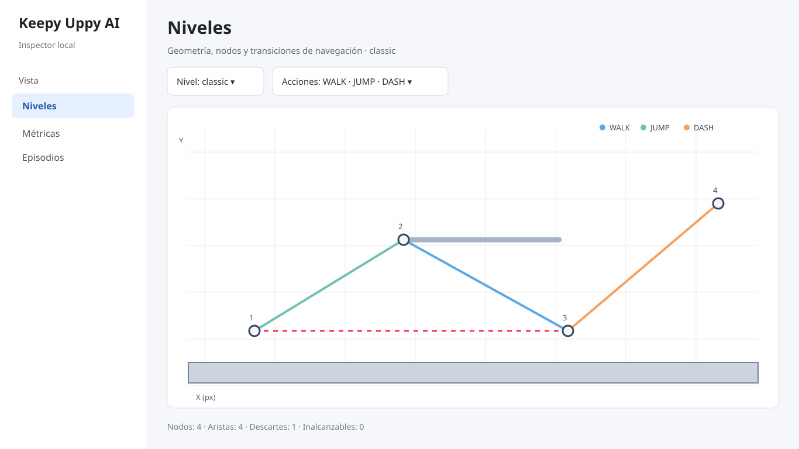
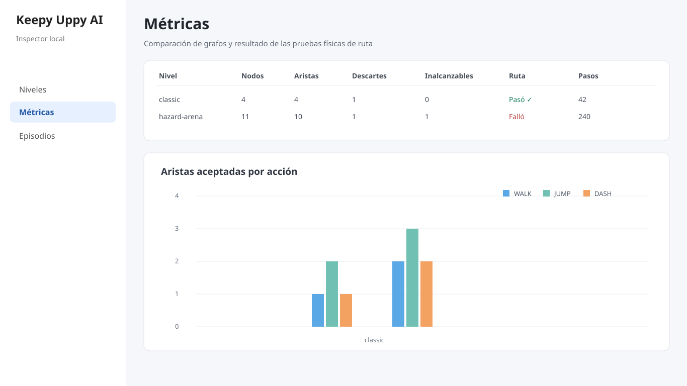

# Local dashboard

The dashboard inspects generated files without requiring a running Godot
instance. Streamlit and Plotly are optional so the Python bridge and training
commands keep their small base environment.

## Install and start

From the repository root, install the visualization extra and start the local
panel:

```sh
uv sync --extra viz
uv run keepy-dashboard
```

The command opens a local Streamlit page. To select another artifact folder,
enter its path in the sidebar. By default, the dashboard looks in the current
working directory for `graphs/`, `reports/`, `geometry/`, and `episodes/`.

## Pages

- **Levels** overlays collision geometry, accepted navigation edges and nodes.
  Filter edges by action. Unreachable nodes are red; rejected movement probes
  use red crosses and show their source, target, action, and reason on hover.
  The page names missing files and continues to offer levels with complete
  artifacts.
- **Metrics** compares node and edge counts, rejected probes, unreachable
  nodes, and the physical route-check result across available reports.
- **Episodes** loads dated JSONL files, reports malformed lines with their
  line numbers, and displays duration, faults, terminal reason, and score.
- **Live** is available when the configured Godot executable and project
  directory exist. It shows bridge observations while the simulation runs.
  Configure `GODOT_BIN` and `GODOT_PROJECT_PATH` as described in the README.

## Data files

Generate graph artifacts with:

```sh
uv run generate-graph --all-levels --seed 42
```

The dashboard discovers these files by level name:

| Directory | File | Contents |
| --- | --- | --- |
| `graphs/` | `<level>.json` | Navigation graph, schema version 1 |
| `geometry/` | `<level>.json` | Original schema-version-one Godot geometry payload |
| `reports/` | `<level>.json` | Edge counts, rejected probes, unreachable nodes, route check |
| `episodes/` | `<date>.jsonl` | One completed episode summary per JSON line |

Use `--graph-dir`, `--geometry-dir`, and `--report-dir` to write graph
artifacts elsewhere. Episode summaries are saved with
`uv run run-episode --save-episodes`; `--episodes-dir` selects their
destination. Details and examples are in the
[graph generation guide](graph-generation.md).

The loaders validate required fields and supported schemas. A missing or
invalid artifact is reported with its path; malformed JSONL records include
the line number, while valid records from the same file remain available.

## Screenshots

These reference views use the included sample schema-version-one artifacts:





